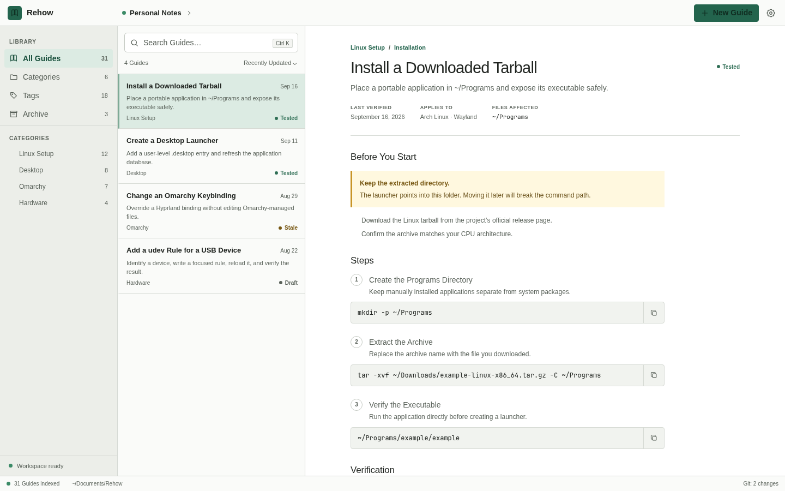

# Rehow

> Remember how you did it.

[](https://github.com/HichemTab-tech/rehow/actions/workflows/ci.yml)

Rehow is a Linux-first, local desktop knowledge application for preserving and finding repeatable technical instructions. Guides stay in a user-selected Workspace as human-readable Markdown, so the content remains portable, inspectable, and Git-compatible.



## What Rehow does

- **Search-first.** Type a title, command, path, or error message and get ranked results instantly, even with typos (`dokcer` finds Docker). `Ctrl+K` opens a command palette for Guides and actions.
- **Write comfortably.** A Markdown editor with live preview, a formatting toolbar, section templates (Steps, Verify, Rollback, Troubleshooting), Tags with suggestions, and `Ctrl+S`. Unsaved drafts survive a crash.
- **Read at a glance.** Warnings, prerequisites, affected files, references, and related Guides sit above the steps; every command block has a one-click Copy.
- **Stay trustworthy.** Guides are Draft, Tested, or Needs retest. Editing a tested Guide marks it for retesting; only you can mark it tested again.
- **Organize simply.** Click a Category, Tag, or status in the sidebar to filter. Archive instead of delete when unsure.
- **Bring your own Markdown.** Drop plain `.md` files into a Category folder and they appear immediately. Rehow adds its metadata block only when you edit and save one.
- **Sync with Git (optional).** Commit, pull, and push from a Source control panel, using your existing SSH keys or credential helper.
- **Work with AI (optional).** A local MCP server lets Claude Code, Claude Desktop, Codex, and other clients search and draft Guides. AI edits always stay Drafts until you test them.
- Works offline, without Git, MCP, or any AI service.

Commands shown in Guides are inert documentation. Rehow never executes them.

## Current status

Rehow `0.2.0` is a functional pre-release. The desktop application, Markdown Workspace, search, Git workflows, Attachments, and MCP server are implemented and tested. Native `.deb`, `.rpm`, and Arch `.pkg.tar.zst` packages build successfully; final clean Ubuntu graphical qualification remains pending.

Linux package baseline: x86_64, glibc 2.39 or newer, and WebKitGTK 4.1. Ubuntu 24.04, Debian 13, and Fedora 44 are the currently qualified package families. See [installation and desktop integration](docs/installation.md) for details and known graphics notes.

## Build and run

The repository uses Node 26.2.0, pnpm 11, and Rust 1.98.0. With those tools already available:

```sh
pnpm install --frozen-lockfile
pnpm tauri:dev
```

Build and inspect all native Linux packages:

```sh
pnpm tauri:build
scripts/build-arch-package.sh
scripts/test-linux-bundles.sh
```

Generated packages are written to:

- `target/release/bundle/deb/Rehow_0.1.0_amd64.deb`
- `target/release/bundle/rpm/Rehow-0.1.0-1.x86_64.rpm`
- `target/release/bundle/arch/rehow-0.1.0-1-x86_64.pkg.tar.zst`

Rehow is a Tauri desktop application. It does not require a permanently running local web server.

## Workspace format

A Workspace is an ordinary folder containing a versioned manifest, Category descriptors, Markdown Guides, and managed Attachments. Markdown and YAML are the source of truth; search indexes and caches are disposable.

Hand-written Markdown files inside a Category folder are listed as-is; Rehow derives their title and summary in memory and adds frontmatter only on your first explicit save, keeping the filename and body unchanged ([ADR 0063](docs/adr/0063-hand-written-markdown-guides.md)). Rehow does not silently adopt, reorganize, migrate, or overwrite an existing folder. Writes are confined to the opened Workspace, atomic, recoverable, and revision-checked. The format and compatibility rules are documented in [the content model](docs/content-model.md).

## MCP server

The local stdio MCP server can be used independently of the desktop application. It receives its allowed Workspaces at startup and never accepts arbitrary filesystem paths through tool calls.

Start it in read-only mode during development:

```sh
cargo run -p rehow-mcp -- \
  --workspace personal=/absolute/path/to/workspace
```

Mutation, broad-operation, and Git-write permissions are separate opt-in startup grants. Tested status and destructive operations still require explicit native approval. See [MCP setup and workflow](docs/mcp-setup.md) for client configuration and the complete authority model.

## Safety principles

- Workspace content, Markdown, filenames, Git repositories, and MCP inputs are treated as untrusted.
- Raw Markdown HTML is disabled, and external links require a native application chooser.
- Managed paths reject traversal, symlink escape, unsafe hard links, and changed-during-read files.
- Git operations do not install hooks, invoke a shell, force-push, hard-reset, discard changes, or resolve ambiguous conflicts.
- Rehow never requests or stores access tokens, passwords, or private SSH keys.
- AI-created or AI-edited Guides are not marked `tested`; only the user can approve an exact Guide revision as tested.

The complete security analysis is in the [threat model](docs/threat-model.md).

## Development

Common verification commands:

```sh
pnpm check
pnpm test
pnpm test:integration
pnpm build
cargo fmt --all --check
cargo clippy --workspace --all-targets --all-features -- -D warnings
cargo test --workspace --all-features
```

Start with [development setup](docs/development.md), then consult the [product specification](docs/product-spec.md), [architecture](docs/architecture.md), and [current progress](PROGRESS.md).

Pull requests run the complete Linux check/package gate. Published GitHub Releases trigger verified `.deb`/`.rpm`/Arch builds; see the [release process and platform policy](docs/release.md).

## License

Rehow is available under the [MIT License](LICENSE).
